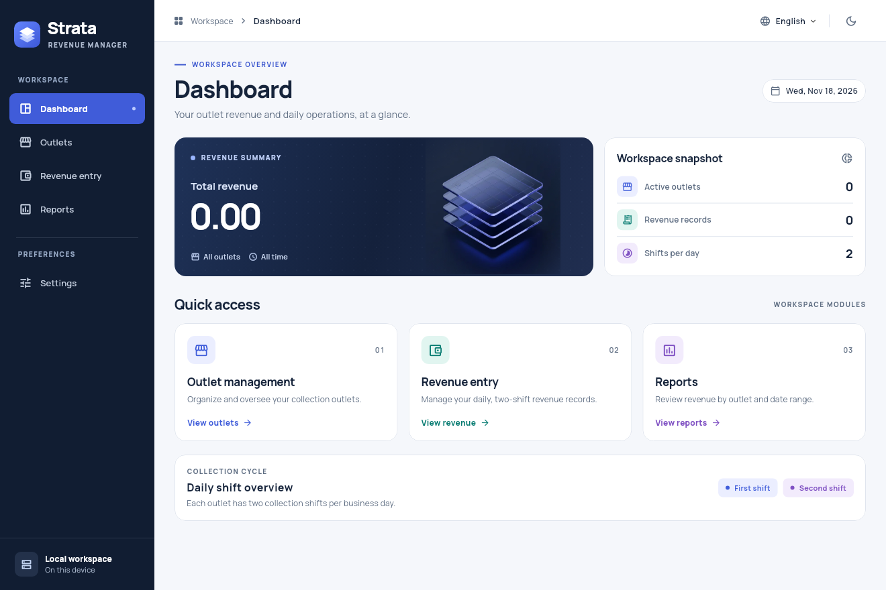

# Ragaa
Roads map

## Strata · Outlets Revenue Management System

Strata is a Flutter application shell for managing outlet collections in two shifts per day. It opens with an **empty workspace**, not demonstration transactions. Dashboard, Outlets, Revenue entry, Reports, and Settings have real routes. Language and appearance preferences work today; recording money and generating reports do not.



[Arabic dark-mode preview](docs/previews/dashboard-ar.png) · [Architecture and open decisions](docs/architecture.md) · [Initialization report](docs/initialization.md)

### Run from a clean checkout

Use **Flutter 3.50.0 stable** (Dart 3.14.0). The application lockfile is checked in. Start in the repository root:

```sh
flutter doctor -v
flutter pub get --enforce-lockfile
flutter gen-l10n
flutter devices
flutter run -d chrome          # or an available device ID
```

For a local web release with the renderer served alongside the application:

```sh
flutter build web --release --no-web-resources-cdn
python3 -m http.server 8080 --directory build/web
```

Open the server over HTTP, not `file://`. The default hash URLs (`/#/outlets`, `/#/revenue`, `/#/reports`, `/#/settings`) work on a static host without rewrite rules. Fonts and dashboard artwork are bundled, not fetched by application code. A self-contained renderer is **not** a promise of offline business-data synchronization.

### Host requirements

| Target | Build host and tooling | Example |
| --- | --- | --- |
| Android | Linux, macOS or Windows; Android SDK, accepted licenses, JDK 17-compatible toolchain. Template minimum API 24, compile SDK 36. | `flutter build apk --debug` |
| iOS | **macOS** with compatible Xcode, command-line tools and simulator runtime. Signing/team configuration is required for distribution to devices. Template target: iOS 15+. | `flutter build ios --simulator --debug` |
| Windows | **Windows** with Visual Studio's Desktop development with C++ workload and Windows SDK. Enable Developer Mode if plugin symlinks require it. | `flutter build windows --debug` |
| macOS | **macOS** with Xcode and desktop tooling. Template deployment target: macOS 12+. Signing/notarization is separate from a debug build. | `flutter build macos --debug` |
| Linux | **Linux** with clang, CMake, Ninja, pkg-config, GTK 3 and C++ development headers. A graphical session is needed to run the desktop app. | `flutter build linux --debug` |
| Web | Any Flutter-supported development host; a modern browser for interactive testing or an HTTP server for the release bundle. | `flutter build web --release --no-web-resources-cdn` |

Use `flutter doctor -v` on the intended host. Run native builds with **Flutter's CLI** so it prepares the generated plugin registrants, Android wrapper, and Apple Swift package metadata. The checked-in application IDs are development placeholders; do not publish them or use Android's debug signing for distribution.

### Project map

```text
lib/
  main.dart                      # restore device preferences, inject dependencies
  app/
    app.dart                     # MaterialApp.router and locale/theme binding
    router/                      # destinations and persistent shell route
    theme/                       # light/dark palettes, typography, accent roles
    localization/                # ARB catalogs, generated delegates, formatters
  core/widgets/                  # shared surface and type primitives
  features/
    dashboard/{application,presentation}/
    outlets/presentation/
    revenue/presentation/
    reports/presentation/
    settings/{application,data,presentation}/
  shared/
    domain/                      # ledger entities, queries, read contract
    data/                        # empty adapter and dependency injection
    presentation/                # sidebar/drawer, toolbar, common page layout
android/ ios/ linux/ macos/ web/ windows/    # real Flutter platform hosts
assets/                          # local typefaces + OFL licenses, brand, artwork
test/                            # widget, domain, formatting and preference tests
docs/                            # architecture, verification and rendered previews
```

### Review checks

```sh
flutter pub get --enforce-lockfile
flutter gen-l10n
dart format lib test
flutter analyze
flutter test
```

To refresh the *actual widget renders* used in this README (not design mockups), run `flutter test --update-goldens test/previews/render_workspace.dart`. These two captures are opt-in; they do not make every host match identical font rasterization.

### Extend the shell

- Add user-facing text to **both** `lib/app/localization/app_en.arb` and `app_ar.arb`, then run `flutter gen-l10n`. Use `context.l10n`, `context.formats` and directional alignment/padding in widgets. Never edit generated translations.
- Put workflow logic in its feature, not in a navigation widget. Only move concepts into `shared/domain` when more than one module needs them.
- Replace `workspaceReaderProvider` with a real adapter only after agreeing on offline behavior, currency and synchronization. Preferences storage is not a ledger.

CI also smoke-tests the **built release** in Chrome: it follows a Settings deep link, changes language and theme, reloads, and verifies persistent choices. To repeat after building web with local renderer assets, install Python `playwright==1.65.2` in a disposable virtual environment and run `python tool/check_web.py` with Chrome on `PATH`. No Playwright dependency is included in the Flutter application.
