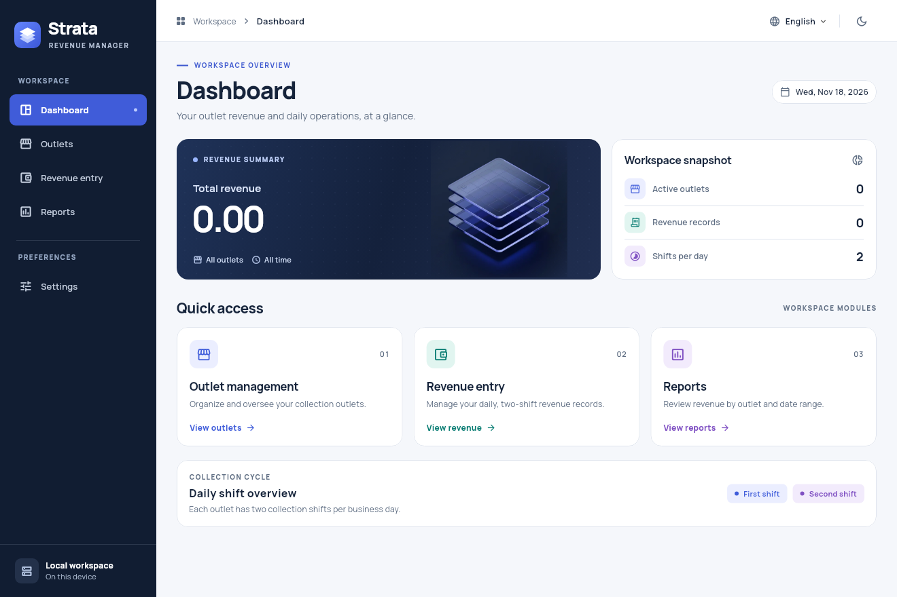

# Initialization report · Strata

The repository previously contained only `README.md` (`# Ragaa` / `Roads map`). No Flutter project, configuration, dependencies or existing application behavior was replaced. The original README text is retained.

## Review scope

- Five routed screens: Dashboard, Outlets management, Revenue entry, Reports and Settings.
- Responsive Material 3 shell, sidebar/drawer, local typography, system/light/dark themes and immediate Arabic/English switching.
- Provider-neutral read boundary, empty production adapter and exact amount formatting. No outlet CRUD, entry submission, revenue calculations, authentication, exports, migrations or synchronization have been shipped.
- Six official platform hosts generated by Flutter 3.50.0 stable. The lockfile and native plugin registrants were produced by Flutter, not guessed.



[Rendered Arabic dashboard in dark mode](previews/dashboard-ar.png)

## Organization and files

The original `README.md` was **expanded**, retaining its original project heading and description. It is the only modified pre-existing file. All other tracked paths are additions; no original file was deleted or renamed.

| New paths | Contents |
| --- | --- |
| Root configuration | `.metadata`, `.gitignore`, `pubspec.yaml`, `pubspec.lock`, `analysis_options.yaml`, `l10n.yaml` |
| `lib/app`, `lib/core`, `lib/main.dart` | Bootstrap, composition, router, Material themes, catalogs/formatting and common primitives |
| `lib/features/{dashboard,outlets,revenue,reports,settings}` | Feature presentation, dashboard query, preference state and platform adapter |
| `lib/shared/{domain,data,presentation}` | Ledger models and contracts, empty read adapter and responsive navigation/layout |
| `android`, `ios`, `windows`, `macos`, `linux`, `web` | Six platform hosts, build configuration and launcher resources |
| `assets`, `test`, `tool`, `.github`, `docs` | Local fonts and artwork, automated tests, release-browser smoke test, CI and review documentation |

See the [directory map](../README.md#project-map) for the full hierarchy and [architecture notes](architecture.md) for boundaries and deferred decisions.

Reproduce the inventory with `git diff --name-status 3f8e4d3415e6fc791727d4dddec59150f100b75b HEAD`.

## Resolved direct dependencies

| Dependency | Locked version | Purpose |
| --- | --- | --- |
| `flutter`, `flutter_localizations` | Flutter SDK 3.50.0 | Cross-platform widgets, directionality and localization services |
| `material_ui` | 1.11.1 | Official Material Design library used by current Flutter templates |
| `flutter_riverpod` | 3.5.0 | State subscriptions and replaceable dependency boundaries |
| `go_router` | 18.1.4 | URL-addressable destinations and a persistent responsive shell |
| `intl` | 0.20.3 | CLDR date, numeral, grouping and decimal symbols |
| `shared_preferences` | 2.5.6 | Device preferences only; not outlet/revenue storage |
| `flutter_test`, `flutter_lints` (dev) | SDK / 6.0.0 | Widget/unit tests and static analysis |

No database driver, network SDK, charting package, PDF library or spreadsheet writer was added. Playwright is confined to the optional **release-browser check**; it is not an application dependency.

## Bilingual behavior

The two catalogs contain 81 matching messages. The ARB catalogs in `lib/app/localization/` generate typed messages. The active locale drives all feature labels, tooltips, empty/error states, app title, formatting and layout direction. The English layout starts on the left; in Arabic the sidebar/drawer and directional spacings mirror to the right. `ar_EG` number/date symbols produce Arabic-Indic numerals. Explicit locale and theme choices are saved as a versioned preference document. Unsupported device languages fall back to English. Storage failure is visible and does not disable the current session.

## Verification

The sandbox could read the Flutter SDK source but could not download its Dart binaries. The following commands actually ran on **GitHub-hosted runners**, not locally. [Quality and browser check on commit `664cf9e`](https://github.com/ahmedragaa79-cell/Ragaa/actions/runs/44276397294/job/134705546018).

| Check | Actual result |
| --- | --- |
| `flutter pub get --enforce-lockfile` | Passed with the checked-in lockfile |
| `flutter gen-l10n` | Both locale classes generated successfully |
| `dart format lib test` | Applied using the pinned SDK; the subsequent `--output=none --set-exit-if-changed` check passed |
| `flutter analyze --no-pub` | Passed; no analyzer findings |
| `flutter test --no-pub --reporter=github` | **12 tests passed**: four app/navigation/preference widget tests, four domain/preference tests, two formatting tests, catalog parity, and dashboard error/retry |
| Opt-in preview renders | Two PNGs rendered from the real Flutter widgets: English/LTR/light and Arabic/RTL/dark |
| Compiled-release Chrome check | Passed: Settings deep link, live switch to Arabic, actual plugin write of locale/theme, full page reload, switch back to English without losing the route |

The widget suite checks the physically mirrored sidebar, 360-pixel RTL drawer, Arabic-Indic digits and dates, and the distinction between a failed read and a zero balance. Earlier formatting/lint findings were fixed. An isolated Chrome test entry point did not verify plugin behavior; the passing browser result above comes from the **actual release app**, not that harness or a mock store.

### Target builds

| Target | Build and scope actually verified |
| --- | --- |
| Web | `flutter build web --release --no-web-resources-cdn` **passed** on Ubuntu. The release was served over HTTP and exercised in headless Chrome. [Download web bundle](https://github.com/ahmedragaa79-cell/Ragaa/actions/runs/44276397294/artifacts/14414807162) (7-day CI artifact). |
| Android | [Debug APK compiled on Ubuntu](https://github.com/ahmedragaa79-cell/Ragaa/actions/runs/44276397294/job/134706633838). No emulator or physical device was run. |
| Windows | [Debug desktop build passed on Windows](https://github.com/ahmedragaa79-cell/Ragaa/actions/runs/44276397294/job/134706633876). No interactive Windows session was tested. |
| Linux | [Debug desktop build passed on Ubuntu](https://github.com/ahmedragaa79-cell/Ragaa/actions/runs/44276005236/job/134704169443). No interactive GTK session was tested. |
| macOS | Official host and Apple language declarations configured. The macOS runner was still queued at handoff; **build not verified**. See [current PR checks](https://github.com/ahmedragaa79-cell/Ragaa/pull/1/checks). |
| iOS | Official host and Apple language declarations configured. Simulator compilation shares the macOS job; **build not verified**. No simulator launch or device test was performed. |

These are observed results as of **18 November 2026 UTC**, not a platform certification. The Linux link points to its successful job on the preceding code revision; the later Dart change only added braces around a preference validation guard.

The [host/toolchain table](../README.md#host-requirements) gives local reproduction commands. CI does **not** sign release binaries, deploy the project, or verify Safari, Firefox, app-store installation, production persistence or sync.

## Git and review

[PR #1](https://github.com/ahmedragaa79-cell/Ragaa/pull/1) targets `main` from `arena/868c7ad2-ragaa`. The platform-assigned branch cannot be renamed to `feature/project-initialization` in this session. The base is `3f8e4d3415e6fc791727d4dddec59150f100b75b`; no work was committed directly to `main` and the PR was not merged.

| Commit | Review focus |
| --- | --- |
| `6f8398c` | Flutter package, locked toolchain choice, source catalogs and font assets |
| `a36286c` | Official platform runner sources and resolved dependency lock |
| `997c312` | Feature shell, domain/read contracts, localization, state and tests |
| `43f3988` | Recoverable device preference snapshots |
| `a518c9e` | SDK formatting and both localized dashboard renders |
| `664cf9e` | Verified code revision and read-only platform-check gating |

## Limits and handoff

- `0.00` is the empty projection, not a sample transaction or a currency decision. Two shifts are modeled; duplicate enforcement, aggregation and writes still need a real transactional adapter.
- Development IDs/signing are not production provisioning. Compiling a target is not a physical-device, installation, accessibility-audit or store-distribution test.
- **Next:** confirm offline/sync, currency/precision, business-day and correction rules; then implement and test the outlet directory against an agreed persistence adapter.

## Appendix: files created

<details><summary>Complete added-file inventory (182 paths, grouped by directory)</summary>

```text
.github/scripts/
    check
.github/workflows/
    flutter.yml
Repository root:
    .gitignore
    .metadata
    analysis_options.yaml
    l10n.yaml
    pubspec.lock
    pubspec.yaml
android/
    .gitignore
    build.gradle.kts
    gradle.properties
    settings.gradle.kts
android/app/
    build.gradle.kts
android/app/src/debug/
    AndroidManifest.xml
android/app/src/main/
    AndroidManifest.xml
android/app/src/main/kotlin/com/example/strata/
    MainActivity.kt
android/app/src/main/res/drawable-v21/
    launch_background.xml
android/app/src/main/res/drawable/
    launch_background.xml
android/app/src/main/res/mipmap-hdpi/
    ic_launcher.png
android/app/src/main/res/mipmap-mdpi/
    ic_launcher.png
android/app/src/main/res/mipmap-xhdpi/
    ic_launcher.png
android/app/src/main/res/mipmap-xxhdpi/
    ic_launcher.png
android/app/src/main/res/mipmap-xxxhdpi/
    ic_launcher.png
android/app/src/main/res/values-ar/
    strings.xml
android/app/src/main/res/values-night/
    styles.xml
android/app/src/main/res/values/
    strings.xml
    styles.xml
android/app/src/profile/
    AndroidManifest.xml
android/gradle/wrapper/
    gradle-wrapper.properties
assets/art/
    ledger-study.webp
assets/brand/
    strata-mark.svg
assets/fonts/
    Manrope-OFL.txt
    Manrope.ttf
    NotoSansArabic-OFL.txt
    NotoSansArabic.ttf
docs/
    architecture.md
    initialization.md
docs/previews/
    dashboard-ar.png
    dashboard-en.png
ios/
    .gitignore
ios/Flutter/
    AppFrameworkInfo.plist
    Debug.xcconfig
    Release.xcconfig
ios/Runner.xcodeproj/
    project.pbxproj
ios/Runner.xcodeproj/project.xcworkspace/
    contents.xcworkspacedata
ios/Runner.xcodeproj/project.xcworkspace/xcshareddata/
    IDEWorkspaceChecks.plist
    WorkspaceSettings.xcsettings
ios/Runner.xcodeproj/xcshareddata/xcschemes/
    Runner.xcscheme
ios/Runner.xcworkspace/
    contents.xcworkspacedata
ios/Runner.xcworkspace/xcshareddata/
    IDEWorkspaceChecks.plist
    WorkspaceSettings.xcsettings
ios/Runner/
    AppDelegate.swift
    Info.plist
    Runner-Bridging-Header.h
    SceneDelegate.swift
ios/Runner/Assets.xcassets/AppIcon.appiconset/
    Contents.json
    Icon-App-1024x1024@1x.png
    Icon-App-20x20@1x.png
    Icon-App-20x20@2x.png
    Icon-App-20x20@3x.png
    Icon-App-29x29@1x.png
    Icon-App-29x29@2x.png
    Icon-App-29x29@3x.png
    Icon-App-40x40@1x.png
    Icon-App-40x40@2x.png
    Icon-App-40x40@3x.png
    Icon-App-60x60@2x.png
    Icon-App-60x60@3x.png
    Icon-App-76x76@1x.png
    Icon-App-76x76@2x.png
    Icon-App-83.5x83.5@2x.png
ios/Runner/Assets.xcassets/LaunchImage.imageset/
    Contents.json
    LaunchImage.png
    LaunchImage@2x.png
    LaunchImage@3x.png
    README.md
ios/Runner/Base.lproj/
    LaunchScreen.storyboard
    Main.storyboard
ios/RunnerTests/
    RunnerTests.swift
lib/app/
    app.dart
lib/app/localization/
    app_ar.arb
    app_en.arb
    localization.dart
lib/app/router/
    app_router.dart
    destination.dart
lib/app/theme/
    workspace_theme.dart
lib/core/widgets/
    surface.dart
lib/features/dashboard/application/
    overview_provider.dart
lib/features/dashboard/presentation/
    dashboard_page.dart
    module_cards.dart
    revenue_summary.dart
    snapshot_panel.dart
lib/features/outlets/presentation/
    outlets_page.dart
lib/features/reports/presentation/
    reports_page.dart
lib/features/revenue/presentation/
    revenue_page.dart
lib/features/settings/application/
    preferences_controller.dart
    workspace_preferences.dart
lib/features/settings/data/
    local_preference_store.dart
lib/features/settings/presentation/
    settings_page.dart
lib/
    main.dart
lib/shared/data/
    empty_workspace_reader.dart
lib/shared/domain/
    outlet.dart
    revenue.dart
    workspace_reader.dart
lib/shared/presentation/
    brand_mark.dart
    module_page.dart
    page_layout.dart
    workspace_shell.dart
    workspace_sidebar.dart
    workspace_toolbar.dart
linux/
    .gitignore
    CMakeLists.txt
linux/flutter/
    CMakeLists.txt
    generated_plugin_registrant.cc
    generated_plugin_registrant.h
    generated_plugins.cmake
linux/runner/
    CMakeLists.txt
    main.cc
    my_application.cc
    my_application.h
macos/
    .gitignore
macos/Flutter/
    Flutter-Debug.xcconfig
    Flutter-Release.xcconfig
    GeneratedPluginRegistrant.swift
macos/Runner.xcodeproj/
    project.pbxproj
macos/Runner.xcodeproj/project.xcworkspace/xcshareddata/
    IDEWorkspaceChecks.plist
macos/Runner.xcodeproj/xcshareddata/xcschemes/
    Runner.xcscheme
macos/Runner.xcworkspace/
    contents.xcworkspacedata
macos/Runner.xcworkspace/xcshareddata/
    IDEWorkspaceChecks.plist
macos/Runner/
    AppDelegate.swift
    DebugProfile.entitlements
    Info.plist
    MainFlutterWindow.swift
    Release.entitlements
macos/Runner/Assets.xcassets/AppIcon.appiconset/
    Contents.json
    app_icon_1024.png
    app_icon_128.png
    app_icon_16.png
    app_icon_256.png
    app_icon_32.png
    app_icon_512.png
    app_icon_64.png
macos/Runner/Base.lproj/
    MainMenu.xib
macos/Runner/Configs/
    AppInfo.xcconfig
    Debug.xcconfig
    Release.xcconfig
    Warnings.xcconfig
macos/RunnerTests/
    RunnerTests.swift
test/
    app_test.dart
    catalog_test.dart
    dashboard_error_test.dart
    flutter_test_config.dart
    formatting_test.dart
    foundation_test.dart
test/previews/
    render_workspace.dart
test/support/
    app_harness.dart
tool/
    check_web.py
web/
    favicon.png
    index.html
    manifest.json
web/icons/
    Icon-192.png
    Icon-512.png
    Icon-maskable-192.png
    Icon-maskable-512.png
windows/
    .gitignore
    CMakeLists.txt
windows/flutter/
    CMakeLists.txt
    generated_plugin_registrant.cc
    generated_plugin_registrant.h
    generated_plugins.cmake
windows/runner/
    CMakeLists.txt
    Runner.rc
    flutter_window.cpp
    flutter_window.h
    main.cpp
    resource.h
    runner.exe.manifest
    utils.cpp
    utils.h
    win32_window.cpp
    win32_window.h
windows/runner/resources/
    app_icon.ico
```

</details>
